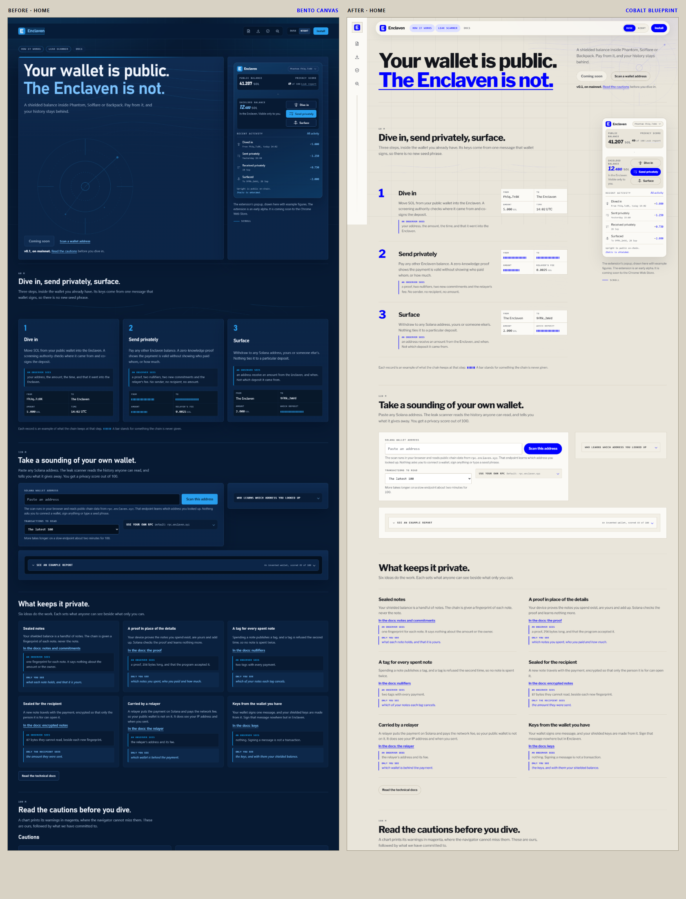
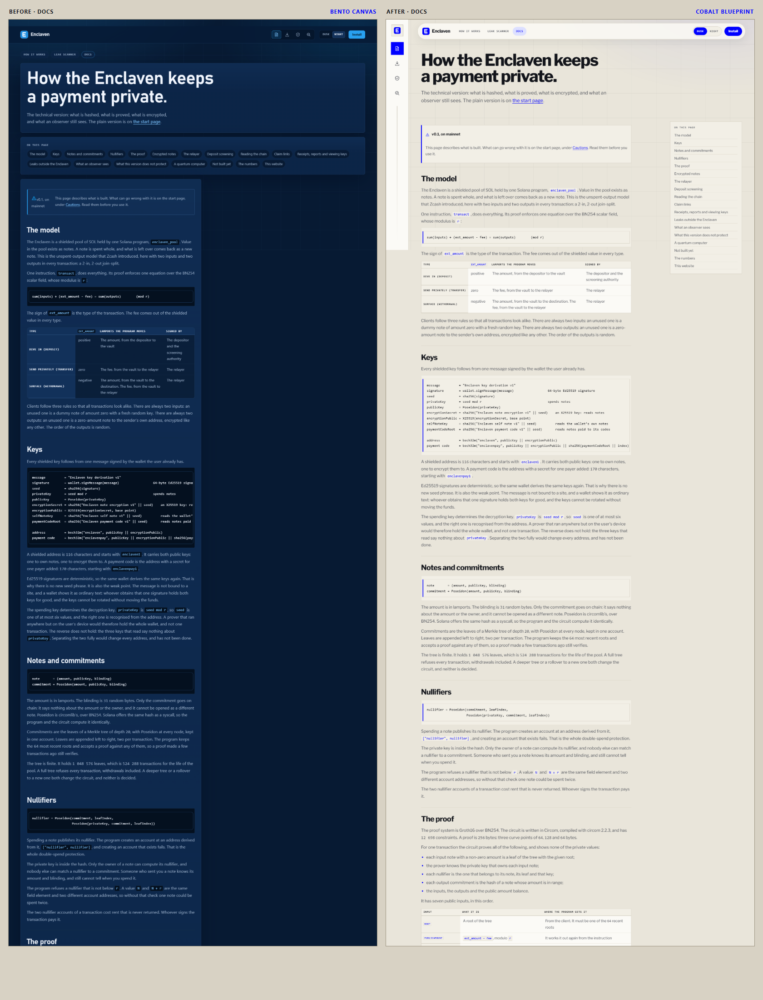
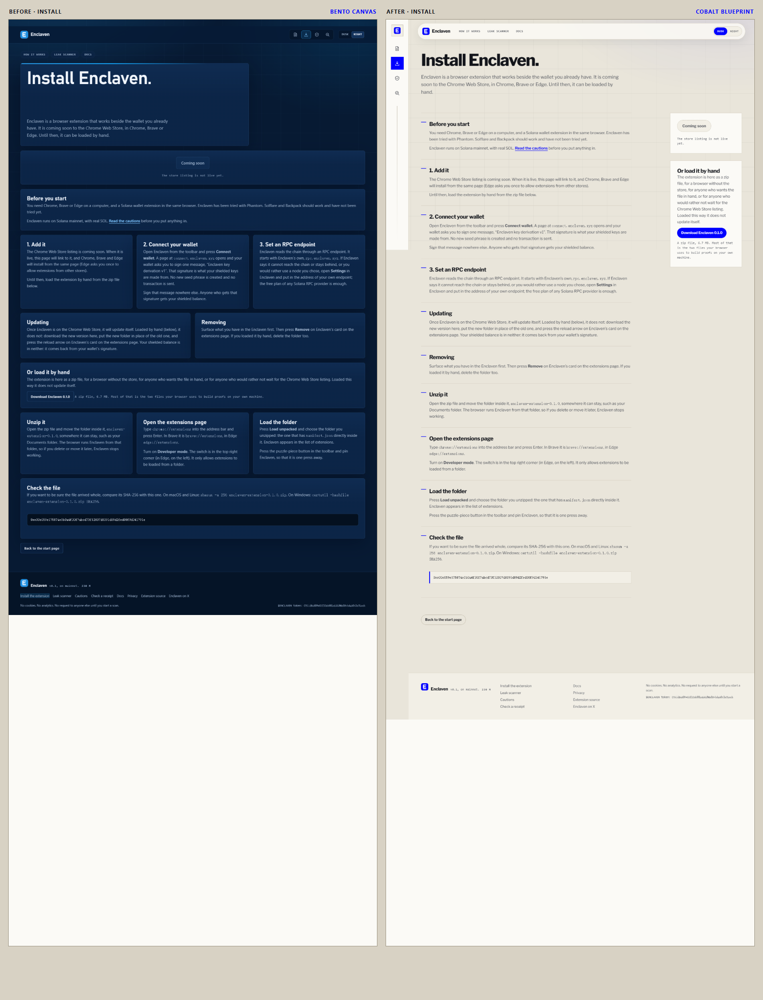
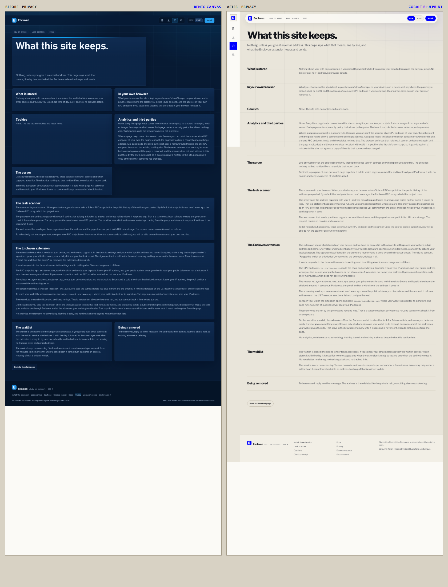
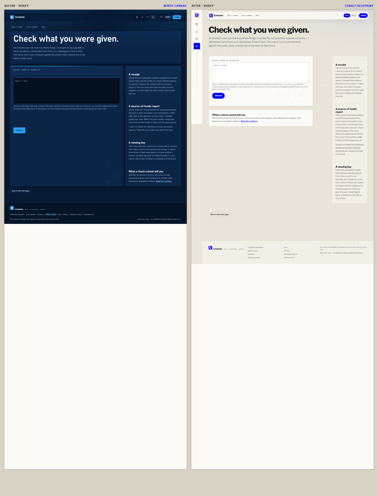

# Reskin report — the Enclaven site rebuilt around Cobalt Blueprint / Command Rail

> The UI was rebuilt around **Cobalt Blueprint** / **Command Rail**; the original
> **bento-canvas** shell and palette were removed while the content contract stayed
> byte-for-byte intact.

- Project: `E:\workspace\chuangye\solana\lochlayer\website`
- Style: `base-cobalt` — **Cobalt Blueprint** (optimistic-modern), live-sampled from
  <https://www.base.org>
- Skeleton: `command-rail` (linear) — see “Skeleton decision” below
- Seed: `213a6ccae06bf5b5fbef6146a364dbccae7e0154404ef142a4867296f3929c8e`
- Original: `bento-canvas` (spatial), accent `#1f8fe0`
- Rebuilt: accent `#0000ff` — **102.32 ΔE** from the original
- Verification: **PASS** — 6 routes, content intact, skeleton replaced, usability clean
- Source content contract: `0edd38237bae0a2cd37372c1ffe0be5576dfe70eeebd0736f251a98e9786b5bd`
  — no token removed or changed; the only differences are two additive warnings
  (the mark image is used one extra time, in the rail)

## Direction

`choose-style.mjs` sampled 8 of 10 blockchain references live (`solana.com` returned
429, `arbitrum.io` 403) and scored every direction for perceptual distance from the
previous accent and ground. It chose **Cobalt Blueprint** at 102 ΔE with **Command
Rail**, a linear skeleton rather than the previous spatial one.

The DNA used here is abstract: a pale blueprint ground ruled with a fine cobalt
grid, white sheets that butt against hairlines instead of floating as cards, one
electric cobalt for rules, marks, fills and links, pill controls, oversized
running heads, and a fixed glyph rail down the left edge. No reference logo,
image, copy or code was used.

The site ships two temperatures of the same skin: **dusk** (the new default — warm
paper, ink and cobalt) and **night** (deep ink blue, pale ink, the same cobalt).
The `localStorage` key, the `?theme=` behaviour, the radiogroup and its arrow keys
are unchanged; only the default palette moved from night to dusk, because the
selected direction is a light one.

## Skeleton decision

The previous shell was a bento canvas: a sticky full-width top index of glyph
chips, a 12-column canvas of touching rounded tiles with one oversized anchor
tile, full-bleed bands and a four-column footer.

The rebuild is a command rail: a **fixed 88 px glyph spine** on the left edge
(mark seal, four route glyphs, a hairline running to the page foot), a **pill
command bar floating 14 px under the top edge** (brand, section links, palette,
install), **oversized running heads in their own band**, an **asymmetric stage**
whose lead column is 8/12 and whose margin column is 3/12 and sticky, ruled
registers instead of card grids, and a **status strip** at the page foot. There is
no top index of chips, no tile grid, no rounded card, no floating corner dock.

| Route | Composition |
|---|---|
| `/` | Running head (h1, lede, actions, v0.1 note) → asymmetric stage: three-step chapter in the lead column, extension popup sticky in the margin → scanner chapter (console sheet 8 + status margin 4, example report sheet below) → six ideas as a ruled two-column index → cautions and commitments as two hairline registers |
| `/docs` | Running head → wide prose column (18 sheet sections) with a sticky “On this page” outline in the right margin |
| `/install` | Running head → procedure register of ten ruled entries with a cobalt tick, sticky margin holding the “Coming soon” panel and the “Or load it by hand” download panel, checksum row inside the last entry |
| `/privacy` | Running head → policy ledger: nine ruled rows, each heading in a narrow term column and the paragraphs in the wide column |
| `/verify` | Running head → console sheet and “What a check cannot tell you” in the lead column, three explanation panels in the margin |
| `/download/enclaven-extension-0.1.0.zip` | SPA fallback; renders the home composition, as before |

Mobile is a genuinely linear version: the rail becomes a top glyph strip, the bar
collapses to brand + palette + install with the section links on a second row,
every stage becomes one column, the outline becomes two columns, and nothing is
hidden to make it fit.

## Screenshots

Comparison sheets (left: the baseline at 1440×900; right: the rebuild, both cut to
the first ~2 000 px of the page):

- Home: 
- Docs: 
- Install: 
- Privacy: 
- Verify: 

Full captures, desktop and 390 px mobile:

| Route | Baseline | Rebuilt |
|---|---|---|
| `/` | [desktop](baseline/home-desktop.png) · [mobile](baseline/home-mobile.png) | [desktop](current/home-desktop.png) · [mobile](current/home-mobile.png) |
| `/docs` | [desktop](baseline/docs-desktop.png) · [mobile](baseline/docs-mobile.png) | [desktop](current/docs-desktop.png) · [mobile](current/docs-mobile.png) |
| `/install` | [desktop](baseline/install-desktop.png) · [mobile](baseline/install-mobile.png) | [desktop](current/install-desktop.png) · [mobile](current/install-mobile.png) |
| `/privacy` | [desktop](baseline/privacy-desktop.png) · [mobile](baseline/privacy-mobile.png) | [desktop](current/privacy-desktop.png) · [mobile](current/privacy-mobile.png) |
| `/verify` | [desktop](baseline/verify-desktop.png) · [mobile](baseline/verify-mobile.png) | [desktop](current/verify-desktop.png) · [mobile](current/verify-mobile.png) |

Review notes, not only numbers: the baseline is a dark navy canvas of touching
tiles under a sticky bar of glyph chips; the rebuild is a paper-blueprint page
behind a fixed left spine and a floating pill bar. The navigation moved from a
horizontal chip strip to a vertical glyph rail; the first viewport's composition
moved from “bar → anchor tile beside the popup tile” to “runhead over an
asymmetric stage whose margin holds the popup”; the steps moved from three equal
cards to ruled rows with the record table in a right-hand column; the palette
moved from cyan-on-navy to cobalt-on-paper.

## Verification

`node …/verify.mjs check --port 4400` exits 0. Every gate:

| Gate | Threshold | Result |
|---|---|---|
| Source content contract | unchanged | intact, 0 issues, 2 additive warnings (`0edd38237bae`) |
| DOM fingerprint (home, worst) | ≤ 0.50 | **0.227** |
| DOM fingerprint (docs / install / privacy / verify) | ≤ 0.50 | 0.122 / 0.155 / 0.188 / 0.131 |
| Landmark sequence (worst) | ≤ 0.68 | **0.571** (docs) |
| CSS class overlap (worst) | ≤ 0.10 | **0.009** (install) |
| Accent distance | ≥ 30 ΔE | **102.32 ΔE** (`#1f8fe0` → `#0000ff`) |
| Archetype bucket | different id and family | `bento-canvas`/spatial → read as `marketing-stack`/editorial |
| Axe serious/critical | 0 | **0** on every route |
| Contrast failures | 0 | **0** on every route, desktop and mobile (256/321/256/73/62/39 pairs) |
| Horizontal overflow at 390 px | none | none on all six captures |
| Keyboard focus visibility | pass | pass |
| Mobile route navigation | reachable | pass (top glyph strip, 48 × 42 px targets) |
| Build / console / page errors | clean | build passed, 0 console errors, 0 page errors |

Rendered word parity: `/` 622, `/docs` 983, `/install` 291, `/privacy` 377,
`/verify` 195, `/download/…zip` 622 — each identical to its baseline count, as are
every document title/description, every rendered attribute and the numeric token
counts.

## Accessibility and responsiveness

- Landmarks: `nav` (glyph rail) → `header` (command bar) → `main` → `nav` (docs
  outline) → `footer` (status strip). The rail is the site navigation and carries
  the four accessible names; the section links sit in a labelled list in the bar.
- Every form field keeps its programmatic label and `aria-describedby` wiring; the
  verify result stays a live `role="status"` region; the scan states keep their
  `role="status"` / `role="alert"` regions; the palette is a labelled radiogroup
  with roving `tabindex` and arrow keys, exactly as before.
- Visible `:focus-visible` rings (2 px cobalt, 2 px offset) on every control; the
  skip link is retained and now offsets past the rail.
- Body contrast is ≥ 4.5 : 1 and large text ≥ 3 : 1 on both temperatures; the
  smallest mono labels were darkened to `#5f636b` (dusk) to clear 4.5 : 1 on the
  sheet background.
- `prefers-reduced-motion: reduce` removes the reveal and all transitions.
- Long instrument strings (checksum, commands, addresses) scroll inside their own
  bordered box; the page never widens at 390 px.
- The stage becomes one column at 1 120 px, the rail becomes a top strip and the
  bar stops being sticky at 860 px; all controls stay ≥ 24 px.

## What changed

Added:

- `src/styles/cobalt.css` — tokens for both temperatures, the blueprint ground,
  the glyph rail, the pill command bar, running heads, the stage grid, panels,
  rules, buttons, forms, console, registers, the status strip, responsive rules
  and the reduced-motion guard
- `src/styles/cobalt-report.css` — the leak report, its plots and its sheets
  re-inked to the blueprint palette (magenta warnings kept, so the copy on the
  start page that names them stays true)
- `src/components/CobaltRail.vue`, `CobaltBar.vue`, `CobaltStatus.vue` — the shell
- `src/components/home/PopupFigure.vue`, `StepsChapter.vue`, `ScanChapter.vue`,
  `IdeasChapter.vue`, `RegistersChapter.vue` — the home chapters, logic carried
  over unchanged

Rewritten / re-presented:

- `src/App.vue` — the rail, the page column and the status strip; views are fragments
- `src/views/{Home, Docs, Install, Privacy, Verify}View.vue` — new compositions;
  every word, binding, handler, id, name and link target carried through (verified
  by the word diff)
- `src/router.ts` — presentational active-link classes renamed
- `src/main.ts` — imports the two new stylesheets
- `index.html` — default palette `dusk`, `color-scheme: light dark`, theme-color
- `src/lib/theme.ts` — the default palette is dusk; storage key and `?theme=` unchanged
- `src/lib/report.ts`, `src/lib/design/**`, `src/data/example-report.html` — class
  namespace renamed to `cb-`, chart ink re-inked for the light sheet
- `public/media/*.svg` — the marks and favicon re-inked to cobalt, the blueprint
  plate re-inked from cyan to cobalt (geometry unchanged)
- `tests/**` — selectors updated to the new markup; **95/95 pass**, `vue-tsc` clean
- `README.md` (root and `website/`) — the presentation paragraphs describe the new skin

Removed from the render path (deleted):

- `src/components/SignalTop.vue`, `SignalIndex.vue`, `SignalFoot.vue`
- `src/styles/signal.css`, `signal-report.css` (deleted, not merely unimported)
- The whole `sn-*`/`ab-*` vocabulary: no `sn-` class, token or selector survives
  anywhere in `src/` or in the rendered DOM. The only shared rendered class is
  `visually-hidden` (by contract), plus `lc-*` chart node names now styled.

## Known limitations

- **Inventory bucket.** `inventory.mjs` classifies source text with keyword buckets;
  the rebuild is read as `marketing-stack`/editorial (oversized running heads read
  as a marketing hero). The implemented skeleton is Command Rail; the gate only
  needs a different archetype id **and** family from the original, and both differ.
- **Keeps popup stays hidden.** The six-idea chapter still carries a second copy of
  the extension popup in source with `display:none`, exactly as the baseline
  rendered it. Its copy is part of the content contract, so it must stay in the
  DOM; it is not visible and does not affect word parity.
- **`/download/…zip`** is a link target rather than a page; the SPA fallback serves
  the home document for it, and it is captured and compared as such.
- **Sticky margins** are static below 1 120 px; the docs outline and install margin
  then read as ordinary blocks between sections rather than beside them.
- **Chart warning colour.** The start page's copy says “a chart prints its warnings
  in magenta”, so the plots keep a magenta warning ink on the cobalt palette rather
  than the site's amber warning token.
- **Fonts.** The display and body face is Libre Franklin, already shipped in
  `public/media` under the SIL OFL; nothing is fetched from a third party. The
  Old Standard TT files remain in `public/media` although the new styles do not use
  them (their licence notices are kept).
- The static capture exercises the closed example report. The live scan report, the
  verify result states and the failure states are covered by the component tests
  rather than a network-dependent screenshot.

## Tests and build

- `npm run build` (`vue-tsc --noEmit && vite build`) passes.
- `npm test`: **95 tests in 12 files pass**.
- `e2e/` was not run here; its selectors (`.cb-btn--soft`, `[data-switch="theme"]`)
  still exist in the rebuilt DOM. The palette assertions address the buttons by
  `data-value`, so they are unaffected.

## Evidence trail

- Pre-reskin source snapshot: `.reskin/pre-round5-src/`
- Previous round's frozen evidence: `.reskin/archive/round4-signal/`
- This round: `.reskin/{inventory,style,verification}.json`, `.reskin/{INVENTORY,STYLE,VERIFICATION,WIREFRAME}.md`,
  `.reskin/{baseline,current,review}/`
