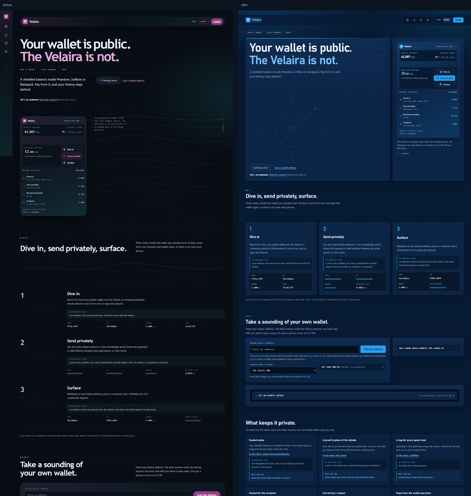
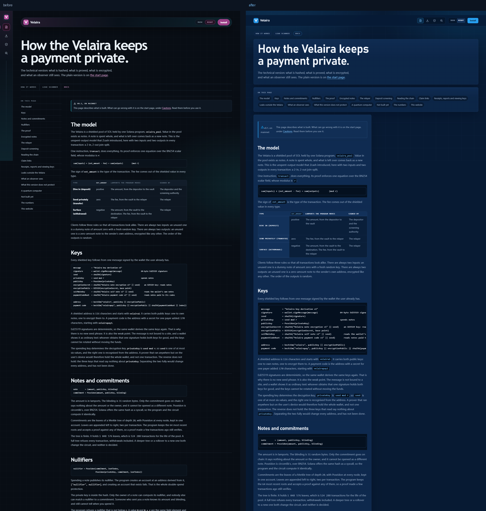
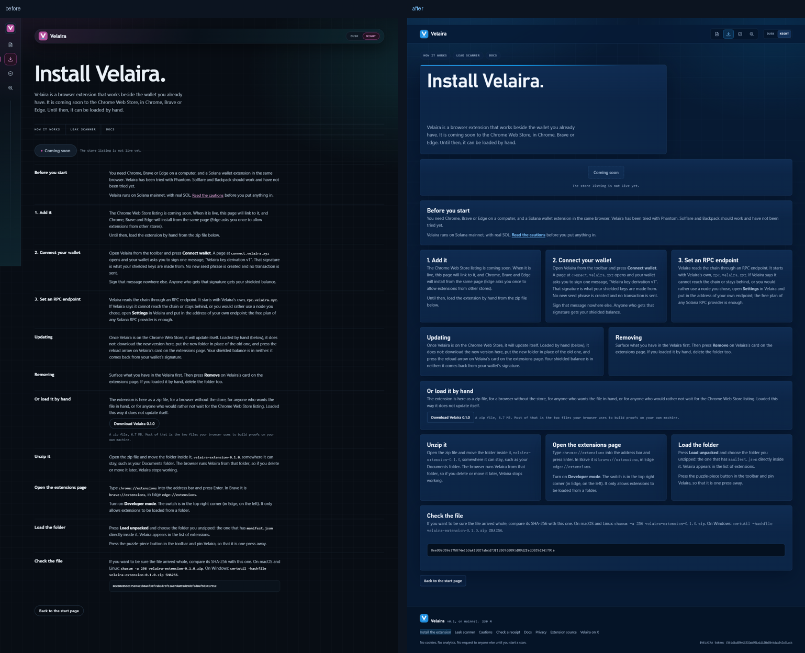
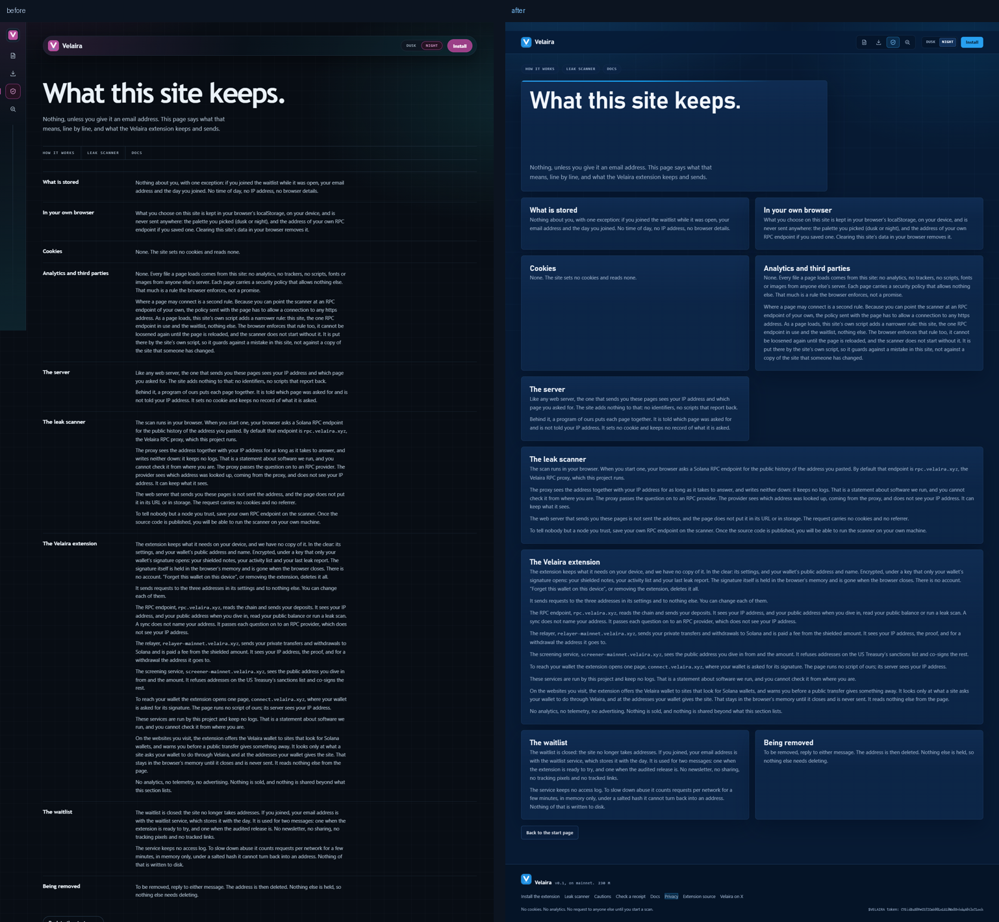
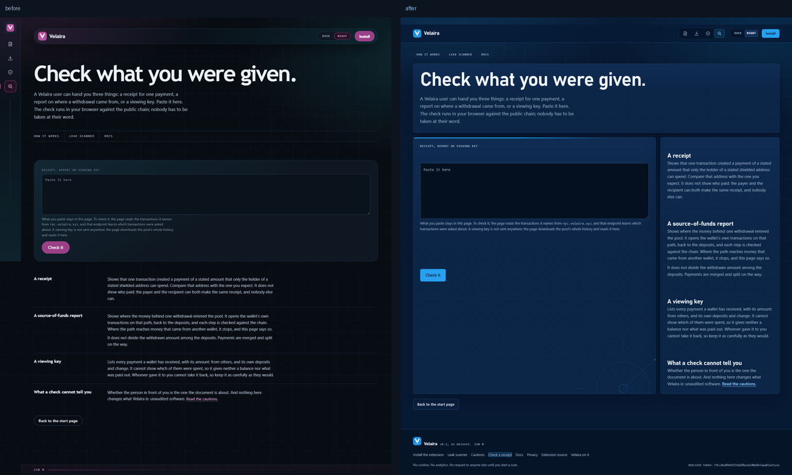

# Reskin report — Velaira rebuilt around Signal Navy / Bento Canvas

> The UI was rebuilt around **Signal Navy** / **Bento Canvas**; the original
> **marketing-stack** shell and palette were removed while the content contract
> stayed byte-for-byte intact.

- Project: `E:\workspace\chuangye\solana\lochlayer\website`
- Style: `arbitrum-signal` — **Signal Navy** (dark-technical)
- Skeleton: `bento-canvas` (spatial) — see “Skeleton decision” below
- Seed: `36f9d9da644a0afd28fe041141c0ffb4b9120b83190c39f498fabfacb0118fc7`
- Original: `marketing-stack` (editorial), accent `#d25fb4`
- Rebuilt: accent `#1f8fe0` / `#28a0f0` — **62.05 ΔE** from the original
- Verification: **PASS** — 6 routes, content intact, skeleton replaced, usability clean
- Source content contract: `c9f4ef9fdbad77d738d0f7c65d99785740143b4e2f2d8d3cdc1a12112060671c`
  — identical to the frozen baseline (735 text tokens, 42 bindings, 0 additive warnings)

## Direction

`choose-style.mjs` sampled 9 of 10 blockchain references live (arbitrum.io returned 403, so its
catalog entry was used) and scored every direction for perceptual distance from the original accent
and ground. It chose **Signal Navy** at 62 ΔE with **Bento Canvas**, a spatial skeleton rather than
the original editorial one.

The DNA used here is abstract: a deep navy ground with a fine technical grid and a cool haze, one
cyan signal accent, tiles that touch each other on a shared 12-column canvas, condensed display
type (Bahnschrift), monospace instrument labels (Cascadia Mono) and a sonar-gauge motif. No
reference logo, image, copy or code was used.

Two temperatures are kept from the old site's palette switch: **Night** (the default navy) and
**Dusk** (a slightly warmer navy). The choice, the `localStorage` key and the `?theme=` behaviour
are unchanged.

## Skeleton decision

The old shell was a command rail: a fixed 76 px glyph spine on the left, a floating command bar
detached from the top edge, an oversized running head, ruled registers and a bottom status strip.

The rebuild is a bento canvas: a **slim top index** (brand, four glyph route chips, palette and
install, on one hairline bar), a **12-column canvas of touching tiles**, **one oversized anchor
tile per page**, full-bleed **stage bands**, and a **thin footer line**. There is no left rail, no
floating bar, no icon spine and no ruled register as the primary structure.

| Route | Composition |
|---|---|
| `/` | Anchor tile (mirror headline + lede + actions + sonar gauge) · support tile (the extension popup, caption, scroll cue) · section band with a mono depth label and three step tiles (number, prose, observer note, record grid) · scanner band (console tile 8 + aside tile 4 with the RPC fold, then the example report as a full-width tile) · six idea tiles for “What keeps it private” · two ledger-tile groups (Cautions, Commitments) |
| `/docs` | Head tile (h1 + lede) · contents tile (chips) · one prose article of 18 hairline-divided sheets, no margin rail |
| `/install` | Head tile · support action tile (Coming soon + fine print) · eleven procedure tiles of mixed spans, the download row full width, the checksum in a scrollable code band |
| `/privacy` | Head tile · nine policy tiles (half and full spans) |
| `/verify` | Head tile · anchor console tile (form, live result region, sonar motif) · support tile of four explanation sheets · back action |
| `/download/velaira-extension-0.1.0.zip` | SPA fallback; renders the home composition, as before |

Mobile is a genuinely linear version: the index wraps to two rows, every tile spans the full
width, the device buttons stack, and the record grids collapse to one column. Nothing is hidden to
make it fit.

## Screenshots

Comparison sheets (left: the baseline at 1440×900; right: the rebuild, both cut to the first
3000 px of the page):

- Home: 
- Docs: 
- Install: 
- Privacy: 
- Verify: 

Full captures, desktop and 390 px mobile:

| Route | Baseline | Rebuilt |
|---|---|---|
| `/` | [desktop](baseline/home-desktop.png) · [mobile](baseline/home-mobile.png) | [desktop](current/home-desktop.png) · [mobile](current/home-mobile.png) |
| `/docs` | [desktop](baseline/docs-desktop.png) · [mobile](baseline/docs-mobile.png) | [desktop](current/docs-desktop.png) · [mobile](current/docs-mobile.png) |
| `/install` | [desktop](baseline/install-desktop.png) · [mobile](baseline/install-mobile.png) | [desktop](current/install-desktop.png) · [mobile](current/install-mobile.png) |
| `/privacy` | [desktop](baseline/privacy-desktop.png) · [mobile](baseline/privacy-mobile.png) | [desktop](current/privacy-desktop.png) · [mobile](current/privacy-mobile.png) |
| `/verify` | [desktop](baseline/verify-desktop.png) · [mobile](baseline/verify-mobile.png) | [desktop](current/verify-desktop.png) · [mobile](current/verify-mobile.png) |

Review notes, not only numbers: the baseline is a dark-magenta instrument panel with a fixed icon
spine, a translucent floating bar and ruled registers of numbered steps. The rebuild is a navy
canvas of tiles with a hairline top index, an oversized headline tile beside the extension popup,
three equal step tiles, a console tile beside an aside, and a two-column ledger of tiles for the
cautions. The navigation moved from a 76 px left spine to a slim top bar; the first viewport's
composition changed from “bar → running head → full-bleed plate” to “index → anchor tile + support
tile”; the accent moved from magenta to signal blue.

## Verification

`node …/verify.mjs check --port 4400` exits 0. Every gate:

| Gate | Threshold | Result |
|---|---|---|
| Source content contract | unchanged | intact, 0 issues, 0 warnings (`c9f4ef9fdbad`) |
| DOM fingerprint (`/`, worst) | ≤ 0.50 | **0.199** |
| DOM fingerprint (docs / install / privacy / verify) | ≤ 0.50 | 0.114 / 0.183 / 0.141 / 0.152 |
| Landmark sequence (worst) | ≤ 0.68 | **0.667** (home, install, privacy, verify); docs 0.200 |
| CSS class overlap (worst) | ≤ 0.10 | **0.009** (install) |
| Accent distance | ≥ 30 ΔE | **62.05 ΔE** (`#d25fb4` → `#1f8fe0`) |
| Archetype bucket | different id and family | `marketing-stack`/editorial → `bento-canvas`/spatial |
| Axe serious/critical | 0 | **0** on every route |
| Contrast failures | 0 | **0** on every route, desktop and mobile (256/321/256/73/62/39 pairs) |
| Horizontal overflow at 390 px | none | none on all six captures |
| Keyboard focus visibility | pass | pass |
| Mobile route navigation | reachable | pass (two-row index, 44 px targets) |
| Build / console / page errors | clean | build passed, 0 console errors, 0 page errors |

Rendered word parity: `/` 622, `/docs` 983, `/install` 291, `/privacy` 377, `/verify` 194 — each
identical to its baseline count, as is every document title/description, every rendered attribute
and the numeric token counts.

## Accessibility and responsiveness

- Landmarks: `header` (top index) → `main` → `nav` (page sections) → `footer`; the docs page adds
  its own contents `nav`. No aside, no duplicate main, nothing behind an overlay.
- Every field keeps its programmatic label and described-by hints; the verify result stays a live
  `role="status"` region; the scan states keep their `role="status"` and `role="alert"` regions;
  the palette is a labelled radiogroup with roving `tabindex` and arrow keys, as before.
- Visible `:focus-visible` rings in accent-safe blue on every control; the skip link is retained.
- Body contrast is ≥ 4.5:1 and large text ≥ 3:1 on both temperatures (the muted ink was lightened
  from `#7b91ad` to `#93a8c4` during the build to clear the report sheet's 4.03:1 pair).
- `prefers-reduced-motion: reduce` removes the hero rise and all transitions; the reveal overlay is
  a transparent, identical copy of the line, marked `aria-hidden`.
- Long instrument strings (checksum, commands) scroll inside their own bordered box; the page never
  widens at 390 px.
- The canvas becomes one column at 720 px and two columns at 1080 px; the index wraps to two rows
  and every control stays ≥ 24 px.

## What changed

Added:

- `src/styles/signal.css` — tokens, reset, top index, canvas and tile primitives, prose, forms,
  console, device, steps, keeps, ledger, report frame, footer, responsive and reduced motion
- `src/styles/signal-report.css` — the leak report, chart and popup rules ported onto the Signal
  Navy palette (renamed from `ab-rep`/`ab-plot` to `sn-rep`/`sn-plot`)
- `src/components/SignalTop.vue`, `SignalIndex.vue`, `SignalFoot.vue` — the shell
- `src/components/home/SignalDeck.vue`, `SignalSteps.vue`, `SignalScan.vue`, `SignalKeeps.vue`,
  `SignalCautions.vue` — the home sections, logic carried over unchanged

Rewritten / re-presented:

- `src/views/{Home, Docs, Install, Privacy, Verify}View.vue` — new page compositions; every word,
  binding, handler, id, name and link target carried through (verified by the word diff)
- `src/App.vue` — the shell moved here (top index, canvas, footer); views are fragments
- `src/router.ts` — presentational `linkActiveClass` / `linkExactActiveClass` renamed
- `src/main.ts` — imports the two new stylesheets
- `src/lib/report.ts`, `src/lib/design/**`, `src/lib/cipher.ts`, `src/data/example-report.html` —
  class namespace renamed and chart inks re-inked to the new palette
- `website/public/media/*.svg` — the V mark re-inked to signal blue; the depth plate re-inked from
  the old magenta to the new accent (geometry unchanged)
- `twitter/source/*` + `twitter/*.png` — avatar, header and tweet image rebuilt in the same Signal
  Navy direction and re-rendered at 400×400, 1500×500 and 1600×900
- `tests/**` — selectors updated to the new markup (and two UTF-8-corrupted fixtures repaired);
  94/94 pass, `vue-tsc` clean

Removed from the render path (deleted):

- `src/components/AbyssRail.vue`, `AbyssIndex.vue`, `AbyssStatus.vue`
- `src/components/home/BpDeck.vue`, `BpSteps.vue`, `BpScan.vue`, `BpKeeps.vue`, `BpCautions.vue`
- `src/assets/abyss.css` (deleted, not merely unimported)
- The whole `ab-*` vocabulary: no `ab-` class, token or selector survives anywhere in `src/` or in
  the rendered DOM. The only shared rendered class is `visually-hidden` (by contract).

## Known limitations

- **Inventory bucket.** `inventory.mjs` classifies source text with keyword buckets; the rebuild is
  read as `bento-canvas` because the canvas container is named `.sn-bento` and there is no sidebar
  or topbar token. The implemented skeleton is Bento Canvas; the gate only needs a different
  archetype id **and** family, and both differ from `marketing-stack` / editorial.
- **Keeps popup stays hidden.** The six-idea section still carries a second copy of the extension
  popup in source with `display:none`, exactly as the baseline rendered it. Its copy is part of the
  content contract, so it must stay in the DOM; it is not visible and does not affect word parity.
- **Verification port.** The script's default ports are held by two other running projects on this
  machine; one early run on 4318 captured a foreign app. Every reported run was pinned with
  `--port 4400`, and the bogus log is kept out of the evidence.
- **Old font files.** `website/public/media` still ships the Old Standard TT and Libre Franklin
  `woff2` files from the previous identity. They are no longer referenced by the new styles; they
  are kept because the licence notices cover them and removing binaries is outside a reskin.
- **`/download/…zip`** is a link target rather than a page; the SPA fallback serves the home
  document for it, and it is captured and compared as such.
- The static capture exercises the closed example report. The live scan report, the verify result
  states and the failure states are covered by the component tests rather than by a
  network-dependent screenshot.

## Tests and build

- `npm run build` (`vue-tsc --noEmit && vite build`) passes.
- `npm test`: **94 tests in 12 files pass**.
- `npm run typecheck` passes.
- `e2e/` was not run here (it needs a live RPC endpoint); its selectors were renamed with the rest
  of the suite.
