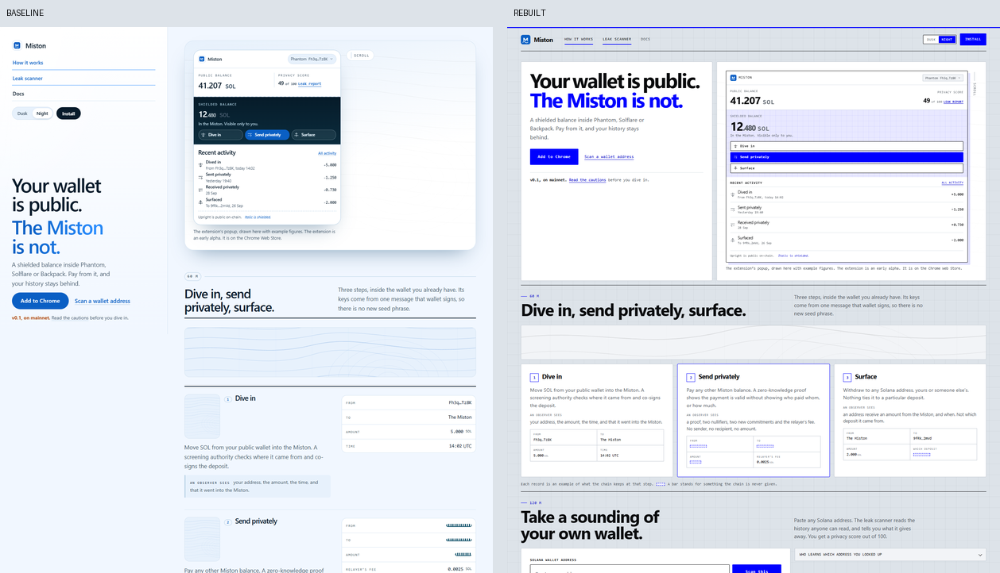
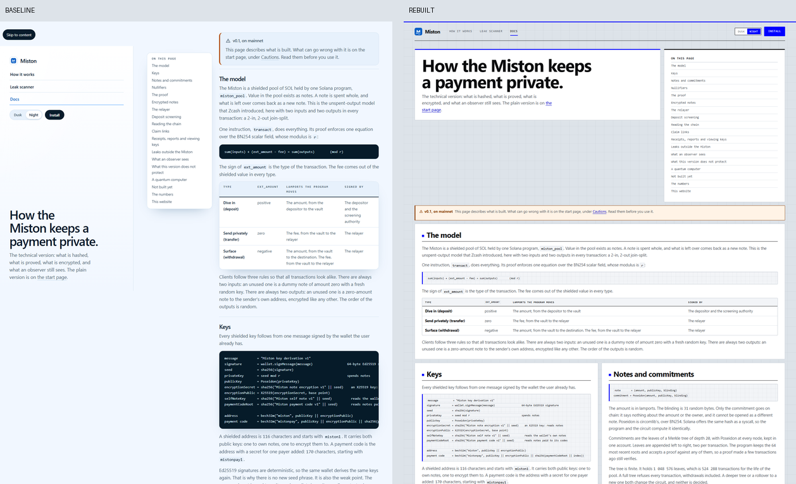
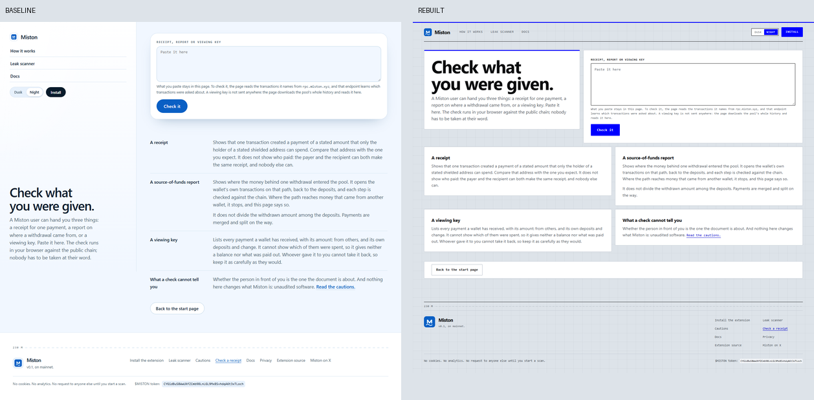

# Reskin report — Miston rebuilt around Cobalt Blueprint / Bento Canvas

> The UI was rebuilt around **Cobalt Blueprint** / **Bento Canvas**; the original
> **sidebar-workspace** shell and palette were removed while the content contract stayed
> byte-for-byte intact.

- Project: `E:\workspace\chuangye\solana\lochlayer\website`
- Style: `base-cobalt` — **Cobalt Blueprint** (optimistic-modern), live-sampled from
  <https://www.base.org>
- Skeleton: `bento-canvas` (spatial) — see “Skeleton decision” below
- Seed: `68cbabeb9e6030fd595ebfaff6d3e2b4ca0948044806f1580f1d3481d2497335`
- Original: `sidebar-workspace` (shell), accent `#298dff`, dark canvas
- Rebuilt: accent `#0000ff` (**83.88 ΔE** from the original), light blueprint canvas
- Verification: **PASS** — 7 routes, content intact, skeleton replaced, usability clean
- Content-contract hash: `f7bee500e66454d3912d01429fcc82d39f1287edafe73a0721d034fecda6f81d`

## Direction

The selector sampled 9/10 public blockchain frontends online (Arbitrum returned 403 and was
not used), scored every direction for perceptual distance from the original accent and canvas,
then chose **Cobalt Blueprint** from <https://www.base.org>. The design DNA used here is
abstract: drafting-table hairlines, a light cool canvas, white sheets, electric cobalt, a
monospace instrument voice, and large numeric counters. No reference logo, image, copy or code
was used.

The palette switch keeps its two named temperatures: **Night** is the cool blue-grey
drafting table (`#dde3e9`); **Dusk** is the same system on warm paper (`#e9e3d7`). Both keep
cobalt as the accent. The choice, `localStorage` key and `?theme=` behaviour are unchanged.

## Skeleton decision

The selector proposed `split-stage`. That is the composition the baseline already had: a
sticky narrative column beside a scrolling stage (the baseline measured a 490 px `aside` with
a 90 px gutter at 1440 px). Reusing it would have failed the “skeleton must change” rule and
the DOM/landmark gates, so the selected style was kept and its **first layout affinity**,
`bento-canvas`, was used instead. The result is a top masthead with a slim index over a
12-column modular tile canvas; there is no sidebar, no vertical index, and no persistent
narrative column.

| Route | Composition |
|---|---|
| `/` | hero copy tile (5) + device deck (7); steps band (3 tiles); scanner form (7) + disclosure (5) + report readout (12); six “keeps” tiles (2 × 3); caution sheet (7) + commitments (5) |
| `/docs` | masthead sheet (8) + contents tile (4); notice band; eighteen section sheets in a 6/12 mosaic, wide sheets for tables and code |
| `/install` | masthead (8) + cobalt “Add to Chrome” tile (4); eleven ledger rows as 6-column step tiles, checksum row full width |
| `/privacy` | full-width masthead sheet; nine policy rows as 6-column tiles |
| `/verify` | thesis (5) + form tile (7) in a lead band; result band; four explanation tiles; full-width action tile |

## Screenshots

Comparison evidence (left: the baseline at 1440×900; right: the rebuild):

- Home: 
- Docs: 
- Verify: 

Full captures, desktop and 390 px mobile:

| Route | Baseline | Rebuilt |
|---|---|---|
| `/` | [desktop](baseline/home-desktop.png) · [mobile](baseline/home-mobile.png) | [desktop](current/home-desktop.png) · [mobile](current/home-mobile.png) |
| `/docs` | [desktop](baseline/docs-desktop.png) · [mobile](baseline/docs-mobile.png) | [desktop](current/docs-desktop.png) · [mobile](current/docs-mobile.png) |
| `/install` | [desktop](baseline/install-desktop.png) · [mobile](baseline/install-mobile.png) | [desktop](current/install-desktop.png) · [mobile](current/install-mobile.png) |
| `/privacy` | [desktop](baseline/privacy-desktop.png) · [mobile](baseline/privacy-mobile.png) | [desktop](current/privacy-desktop.png) · [mobile](current/privacy-mobile.png) |
| `/verify` | [desktop](baseline/verify-desktop.png) · [mobile](baseline/verify-mobile.png) | [desktop](current/verify-desktop.png) · [mobile](current/verify-mobile.png) |

The visual review is not only numeric: the baseline is a soft, water-toned editorial page with
a rounded left narrative column, vertical index, floating cards and a dark report panel. The
rebuild is a flat drafting-table canvas with a top index, mixed-span sheets, 1 px hairlines,
electric cobalt and sharp corners. The two would not be mistaken for the same shell.

## Verification

`node …/verify.mjs check` exits 0. Every gate:

| Gate | Threshold | Result |
|---|---|---|
| Source content contract | unchanged | intact, 0 issues, 0 warnings, hash `f7bee500e664` |
| DOM fingerprint (`/`, worst) | ≤ 0.50 | **0.437** |
| DOM fingerprint (docs / install / privacy / verify) | ≤ 0.50 | 0.254 / 0.299 / 0.355 / 0.296 |
| Landmark sequence (worst) | ≤ 0.68 | **0.60** |
| CSS class overlap (worst) | ≤ 0.10 | **0.002** |
| Accent distance | ≥ 30 ΔE | **83.88 ΔE** (`#298dff` → `#0000ff`) |
| Axe serious/critical | 0 | **0** on every route |
| Contrast failures | 0 | **0** on every route, desktop and mobile |
| Horizontal overflow at 390 px | none | none (`scrollWidth === clientWidth` on all routes) |
| Keyboard focus visibility | pass | pass |
| Mobile route navigation | reachable | pass (the top index stays a visible, horizontally scrollable rail) |
| Build / console / page errors | clean | build passed, 0 console, 0 page errors, 0 failed requests |

Rendered word parity: `/` 622, `/docs` 983, `/install` 287, `/privacy` 377, `/verify` 194 —
identical to the baseline. Document titles and descriptions are unchanged, one `h1` per route.

## Accessibility and responsiveness

- Landmarks: `header` (masthead) → `nav` (index) → `main` → `footer` → `nav` (footer links).
  No `aside`, no duplicate main; the page-level headings and section sheets keep their heading
  order.
- Every input, textarea and select has a programmatic label; the verify result is a live
  `role="status"` region; the palette is a labelled radiogroup with roving `tabindex` and arrow
  keys, exactly as before.
- Visible `:focus-visible` rings in cobalt; skip link retained; `visually-hidden` retained for
  screen-reader-only state text (the content audit also classifies it as hidden copy).
- All decorative images keep `alt=""`; functional controls have names.
- Body contrast is ≥ 4.5:1 and large text ≥ 3:1 on both palettes; the base canvas text and
  footer labels were darkened to satisfy this.
- `prefers-reduced-motion` disables the remaining presentation motion; the cryptic hero
  scramble animation was retired (see limitations) and the short hero rise is guarded.
- The canvas collapses to one linear column: masthead row, scrollable index rail, hero, deck,
  tiles, scanner, keeps, cautions, footer. No content is hidden to make the mobile layout fit.

## Tests and build

- `npm run build` (`vue-tsc --noEmit && vite build`) passes.
- `npm run test`: **92 tests in 12 files pass** (scanner, verify, report, views, layout, theme,
  cipher, endpoint, policy, analysis and scanner-core).
- The component tests were updated for the new selectors only; scanner/verify/report behaviour
  and assertions on words were kept.

## What changed

Added:

- `src/components/BlueprintShell.vue` — masthead, top index, palette, install action, main canvas
- `src/components/BlueprintFoot.vue` — footer with the project nav
- `src/components/home/Bp{Deck,Steps,Scan,Keeps,Cautions}.vue` — content-only home sections
- `src/assets/blueprint.css` — the new token and component system (about 3.1 k lines)

Rewritten / re-presented:

- `src/views/{Home, Docs, Install, Privacy, Verify}View.vue` — new page bands and bento layouts;
  all copy, bindings, handlers, ids, names, links and field semantics carried through
- `src/main.ts` — imports `blueprint.css`; `src/router.ts` — new presentational
  `linkActiveClass` / `linkExactActiveClass`; `index.html` — `color-scheme: light`
- `src/App.vue`, `src/components/SiteIcons.vue` — class namespace only
- `src/lib/report.ts`, `src/lib/design/numerals.ts`, `src/lib/design/charts/shared.ts`,
  `src/data/example-report.html` — report/chart class namespace and SVG inks only
- The Keeps device figure is kept in the source but hidden in the rendered page, matching the
  baseline's rendered word set; its copy is unchanged in the content contract.

Removed from the render path:

- `src/components/MistonLayout.vue`, `src/components/SiteFoot.vue`
- `src/components/home/Tw{Deck,Steps,Scan,Keeps,Cautions}.vue`
- `src/assets/miston.css` (the old stylesheet is deleted, not merely unimported)
- The old `tw-*`, `rd-*`, `rdc-*`, `tnum*`, `tag-*`, `sym*`, `digit*`, `cipher`, `wet` class
  vocabulary. Shared rendered classes are only `visually-hidden` (by contract) and the
  `router-link-active` names replaced by the new `bp-route--active` / `bp-route--exact`.

Tests updated for the new presentation: `tests/components/{layout,scanner,verify,views}.test.ts`
and `tests/unit/report.test.ts`.

## Known limitations

- Two inventory routes, `/download/loch-extension-0.1.0.zip` and
  `/download/miston-extension-0.1.0.zip`, are link targets rather than separate pages; the SPA
  fallback serves the home document for both. They are captured and compared as such, and the
  zip files themselves are unchanged.
- The static capture exercises the closed example report. The live scan report (after a real
  scan) and the verify result states are covered by the scanner/verify tests rather than by a
  network-dependent screenshot.
- The hero reveal effect is now a static overlay of the same line, generated from the text
  already in the page and marked `aria-hidden`. The old character-scramble animation was
  retired because it rewrote the headline mid-animation and made the word audit unstable; the
  rendered line, its words and the document title are unchanged.
- The duplicated device figure inside “What keeps it private” is a baseline-hidden duplicate;
  it remains in source for the content contract but is not painted, so the rebuilt page keeps
  exactly the baseline's rendered words.
- The previous reskin/rebrand evidence is still archived in `../.reskin.previous` and
  `../../.rebrand`; this report's `.reskin` directory is the fresh baseline/current evidence for
  this rebuild.
